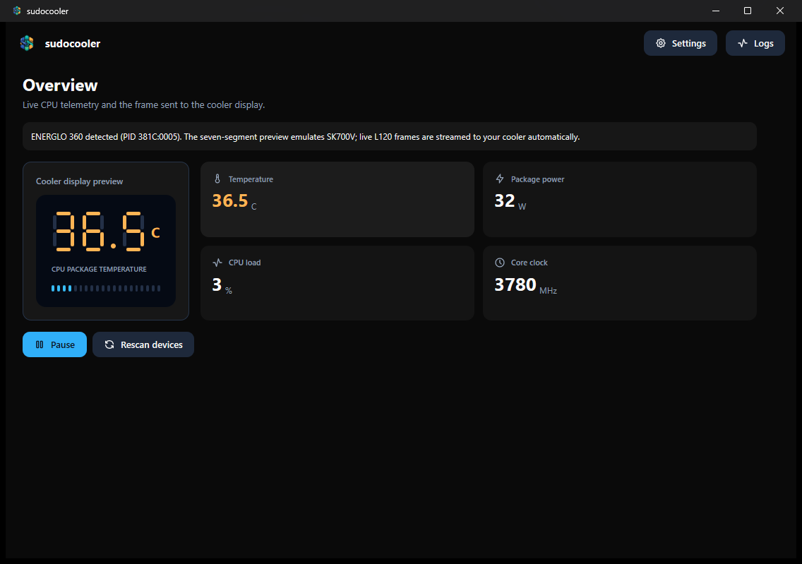

# sudocooler

[](https://github.com/msartore/sudocooler/actions/workflows/ci.yml)

`sudocooler` is a native desktop app for Sudokoo CPU coolers. It shows live CPU
telemetry, streams frames to the cooler's display, and keeps the connection
available from the system tray. It is written in Rust with
[Native Shell (NSH)](https://nsh.dev) (NSH 0.5): one crate for Windows, Linux and
macOS, with no bundled JavaScript VM.

The hardware work is done by the `sudokooler` daemon, included as a git submodule
at [`sudokooler/`](sudokooler/). This repository contains only the app; the daemon
keeps its own build, tests and hardware safety rules.

## Screenshots



> The daemon's own name and paths keep the upstream `sudokooler` spelling.

## Supported hardware

- **Sudokoo SK700V** (`VID 0x381C`, `PID 0x0003`) — **verified**. The daemon's
  enabled profile drives the seven-segment panel with the 64-byte SK700V HID
  report protocol.
- **Sudokoo ENERGLO 360** (`VID 0x381C`, `PID 0x0005`) — its **L120 frames are
  decoded** from MasterCraft 1.0.6 and the app can stream telemetry to the
  display. The upstream daemon registry still marks this PID unverified and
  disabled, so treat it as experimental; identification and streaming support
  do not imply a verified write profile. Other `0x381C` PIDs are detected but
  never written to.

There is **no image or wallpaper support on the cooler**: the display shows
numeric telemetry and a seven-segment preview, not arbitrary graphics.

## Features

- **Live telemetry** — CPU temperature, package power, load and core clock,
  polled from the daemon at a configurable interval (100 ms minimum), with
  pause/resume and rescan actions.
- **L120 frames** — a 19-byte telemetry frame is encoded and streamed to the
  ENERGLO 360 on each tick; the display-open frame is sent once and a display-off
  frame is sent on quit.
- **Packet inspector** — the SK700V 64-byte report and recent L120 frames as
  contiguous hex, in a bounded log.
- **Device list** — HID interfaces from the OS tree with enabled/verified status;
  unverified PIDs are visible but stay read-only.
- **System tray** — icon with Show window, Pause/Resume and Quit. Closing the
  window hides the app into the tray instead of exiting; opening it again brings
  the existing instance forward (single instance). Quitting from the tray closes
  the cooler display cleanly.
- **Settings** — polling interval, temperature unit sent to the cooler, Windows
  logon autostart, and links to the app, daemon and website.
- **Sensor source** — see [Temperature and power](#temperature-and-power) below.

## Temperature and power

On Windows, CPU load and effective clock speed come from Win32 PDH. Windows has
no built-in user-mode API for desktop CPU temperature or package wattage, so the
daemon uses one of two backends for those two values:

- **PawnIO** (recommended, standalone) — reads Ryzen `Tctl/Tdie` and RAPL package
  power via a signed module, but requires an **elevated** process to open the
  PawnIO device.
- **HWiNFO64 shared memory** — no PawnIO and no elevation required, but HWiNFO64
  must be running with Shared Memory Support enabled; the free edition disables
  it after 12 hours.

Without PawnIO or HWiNFO64, load and clock still work, but temperature and power
are reported as `0.0 °C` / `0 W`. This app does not invent those numbers.

On Linux, the daemon reads temperature, power, load and frequency from sysfs
(`/sys/class/hwmon`, `powercap`, `/proc/stat`, `cpufreq`) with no extra background
app or elevation. HID access needs a udev rule for VID `0x381C`; the daemon's
submodule ships `packaging/99-sudokooler.rules` (installed by the Linux package).

## Architecture

```
src/
  domain/          std-only value objects: telemetry, devices, packets, settings
  application/     ports and use cases (no nsh, no processes)
  infrastructure/  daemon CLI adapter, HID writer, autostart, OS HID tree, demo adapter
  composition/     the only module that names concrete adapters
  ui/              styled NSH components (cards, pills, 7-segment display)
  presentation/    app shell, tray and the four screens
sudokooler/        git submodule: the upstream Rust daemon
docs/screenshots/  screenshots used in this README
```

Dependencies point inward. `domain` cannot import NSH; `presentation` cannot
import process or platform code. The seam is `composition`.

## Build and run

Install the [`nsh` CLI](https://nsh.dev) and a Rust toolchain, then:

```sh
git submodule update --init --recursive

# Build the daemon first if you want live hardware data:
cargo build --release --manifest-path sudokooler/Cargo.toml

# Run the app:
nsh run
# or, directly on this machine's desktop backend:
cargo run

# Checks and tests:
cargo check
cargo test
nsh test
nsh check
```

The app looks for the daemon binary in `SUDOKOOLER_BIN`, then in the
`sudokooler/target/{release,debug}/` locations (including the repo-relative
debug build). If it is not found, the UI shows a readable error; building the
daemon first is the simplest fix.

> Hardware safety is unchanged: only enabled profiles with `VID == 0x381C` are
> ever written to. This UI does not enable unverified PIDs.

## Autostart

The **Start at login** row in Settings manages a Windows Scheduled Task named
`sudocooler`. It is created with `schtasks.exe /Create /TN sudocooler /SC ONLOGON
/RL HIGHEST /F`: it runs at logon with **highest privileges** (elevated) and no
console window. Elevation is needed for PawnIO-based temperature and power
readings. Turning the setting off deletes the task. On Linux the same setting
writes an XDG autostart entry at `~/.config/autostart/sudocooler.desktop`;
no elevation is needed there. Both use this app's own executable, not the
daemon's installer.

## Updates

Packaged builds can update themselves from GitHub Releases. **Settings → Software
update** checks `latest.json` from this repository's latest release; NSH verifies
the app id, that the version is newer, the HTTPS URL and the archive's SHA-256.
**Settings → Install update** downloads that verified archive, replaces the
installed app and restarts it. Development builds report that an update requires
a packaged app. Releases publish `latest.json` (generated by `nsh update-manifest`)
alongside the setup and portable archives.

## Open source

Built on the shoulders of:

- [Native Shell (NSH)](https://nsh.dev) — Rust UI framework and CLI.
- [sudokooler daemon](https://github.com/BGW-10/sudokooler) — hardware protocol
  implementation and sensor backends.
- [Tabler Icons](https://tabler.io/icons) — icons in `assets/icons/`.
- Rust crates including `hidapi`, `nsh-core`, `nsh-base`, the `nsh-*`
  platform backends, `env_logger`, and `winres` at build time
  (`nsh-engine` / `nsh-testing` for tests).

## Links

- App: https://github.com/msartore/sudocooler
- Daemon: https://github.com/BGW-10/sudokooler
- Website: https://msartore.dev

## License

Licensed under the GNU General Public License version 3 (GPL-3.0). See
[LICENSE](LICENSE) for the full text.
